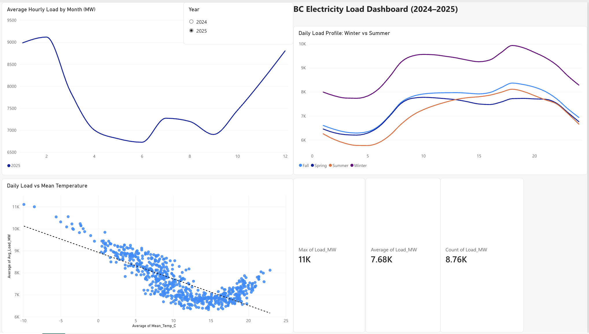

# BC Electricity Load & Temperature Dashboard (2024–2025)

How does the weather change how much electricity BC uses? I took two years of
hourly load data from BC Hydro, matched it with daily temperature in Vancouver,
and looked at it in Excel and Power BI.

## Data

| Data | Source | Size |
| --- | --- | --- |
| Hourly load (MW), 2024 and 2025 | [BC Hydro – Balancing Authority Load, Historical Transmission Data](https://www.bchydro.com/energy-in-bc/operations/transmission/transmission-system/balancing-authority-load-data/historical-transmission-data.html) | 17,544 rows (one per hour) |
| Daily mean temperature, Vancouver Int'l A | [Environment and Climate Change Canada – Historical Climate Data](https://climate.weather.gc.ca/) | 731 days |

Load is the hourly average for the BC Hydro balancing authority, in megawatts.
HE means "hour ending", so HE 1 is 00:00 to 01:00.

## What I did

### 1. Cleaned and checked the data (Excel)

- Combined the 2024 and 2025 files into one sheet (`Data`) and kept the raw
  columns unchanged. Helper columns (real date, hour, year, month, weekday,
  season) are built with formulas.
- Checked every day has 24 hours with `COUNTIFS`. 4 days did not, and all 4 are
  daylight saving days: 2 spring days with 23 hours and 2 fall days with
  25 hours. The extra fall hour shows up as `2*` in the raw file. I turned it
  into hour 2 and kept both rows, because both are real load.
- 36 days have no temperature in the weather file. I left them blank instead of
  filling them with 0, since 0°C is a real temperature. These days are left out
  of the temperature analysis.
- All checks are listed in the `Checks` sheet.

### 2. Matched load with temperature (Excel)

- `Daily` sheet: one row per day with hours recorded (`COUNTIFS`), average load
  (`AVERAGEIFS`) and peak load (`MAXIFS`).
- Brought in the daily temperature from the `Weather` sheet with `XLOOKUP`,
  matched by date. Every load date found a weather date.

### 3. Summarized (Excel)

- Pivot table (`Sheet1`): average load by month, 2024 vs 2025.
- `Summary` sheet: load by month, by hour and season, weekday vs weekend, and
  temperature vs load (`CORREL`, `SLOPE`, `RSQ`).

### 4. Built the dashboard (Power BI)

One page in Power BI, built from the `Data` and `Daily` tables:

- Average hourly load by month, with a year slicer
- Daily load profile (24 hours) by season
- Daily average load vs mean temperature, with a trend line
- KPI cards: max load, average load, number of hours

The PDF export is in [`dashboard/`](dashboard/BC_Electricity_Load_Dashboard.pdf).

## What I found

- **Colder days use more power.** Daily average load goes up about **121 MW for
  every 1°C drop** (correlation -0.78, R² 0.61, 695 days with temperature).
- **The peak was the coldest day.** The highest hourly load was **12,334 MW** on
  January 12, 2024, in the hour ending at 6 pm. That day had a mean temperature of -9.9°C, the
  coldest day in the data.
- **February 2025 was 10% higher than February 2024.** It was also colder: the
  mean temperature was 2.8°C in 2025 and 5.6°C in 2024.
- **Winter evenings are the busiest time.** In the hour ending at 6 pm, winter load is about 21%
  higher than summer load.
- **Weekdays use about 4% more** than weekends.
- Hours at or above 10,000 MW went from 166 in 2024 to 244 in 2025.

## Limits

- Two years is not enough to say the cold *causes* the higher load. The data
  only shows they move together.
- The scatter plot is not a straight line. Above about 15°C the points start to
  go up again, likely from air conditioning, so the straight trend line does
  not fit hot days well.
- Temperature is from one weather station in Vancouver. BC is much bigger than
  that.

## Files

| File | What it is |
| --- | --- |
| `BC_Load_Analysis.xlsx` | Excel workbook: raw data, checks, daily table, pivot table, summary, Excel charts |
| `dashboard/BC_Electricity_Load_Dashboard.pdf` | Power BI dashboard, exported as PDF |
| `images/powerbi_dashboard.png` | Screenshot of the Power BI dashboard |
